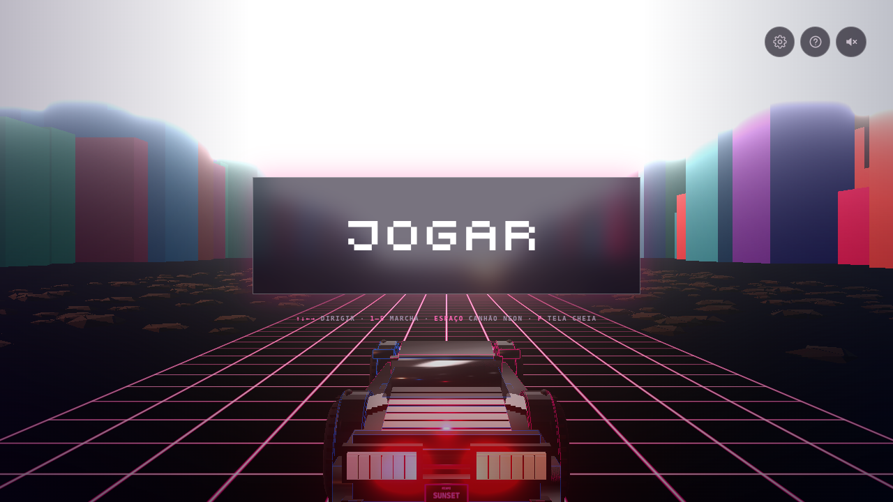

# Sunset Drive 🌅🚗

**Um jogo grátis pra dirigir sem pressa por uma estrada synthwave ao pôr do sol.**

Nasceu de uma brisa jogando GTA V: aquele momento em que você só quer pegar o carro e dirigir, com música e a cidade passando. Sunset Drive tenta transmitir essa sensação no navegador — sem cadastro, sem custo, só pra quem quiser passar um tempinho.



## O que já tem
- Carro detalhado em Three.js com câmera de perseguição (atrás do carro).
- Estrada neon com skyline, palmeiras e prédios surgindo na névoa.
- Câmbio com marchas (1–6), torque e HUD circular de velocidade/torque.
- Trânsito com troca de faixa e colisões.
- Rampa lateral com salto, placas de aviso e moedas para coletar.
- Canhão neon (Espaço) e contador de carros atingidos.
- Áudio, tela cheia (F), painel de configurações e de atalhos.
- Deploy automático no GitHub Pages.

## Como jogar
| Ação | Tecla |
|---|---|
| Dirigir | setas |
| Marchas | 1–6 |
| Canhão neon | Espaço |
| Tela cheia | F |

## Rodar localmente
```bash
npm install
npm run dev        # desenvolvimento
npm run build      # build de produção
npm run test:sites # testes do worker
npm run test:smoke # fumaça headless (precisa do build + Chromium do Playwright)
```

Para o teste de fumaça, rode `npm run build` antes e, na primeira vez, `npx playwright install chromium`. A CI (`.github/workflows/ci.yml`) roda build, `test:sites` e `test:smoke` em todo PR.

## Roadmap
- Mais desempenho (meta 60 FPS em notebook comum).
- Modelos 3D para os carros do trânsito.
- Visão em 1ª pessoa (de dentro do carro) — **planejado**.
- Rádio com estações, ciclo dia/noite, novos cenários.

Plano completo em **[PLANO.md](PLANO.md)**. Histórico detalhado em [progress.md](progress.md).


> Este README e o PLANO.md foram reorganizados em 21/10/2026 a partir da visão do André. Itens marcados como **planejado** ainda não existem no código.
